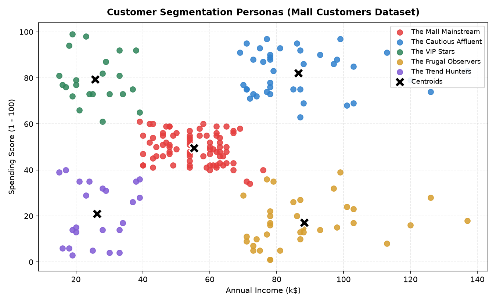
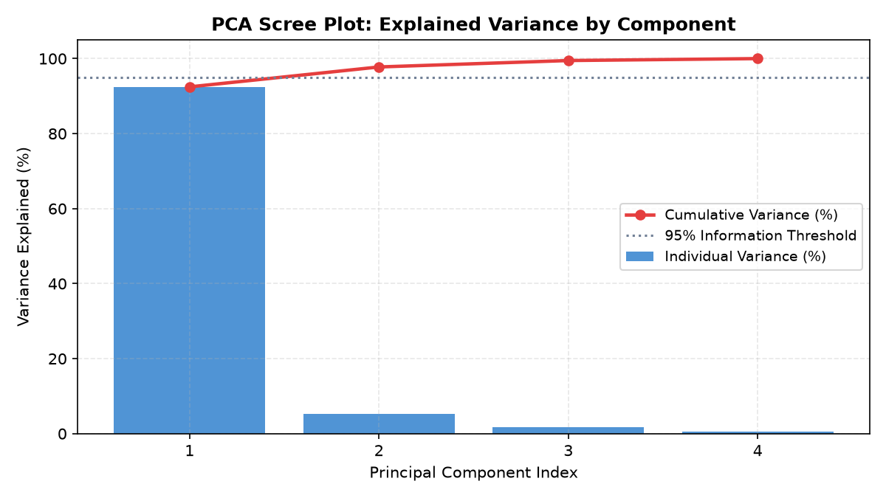
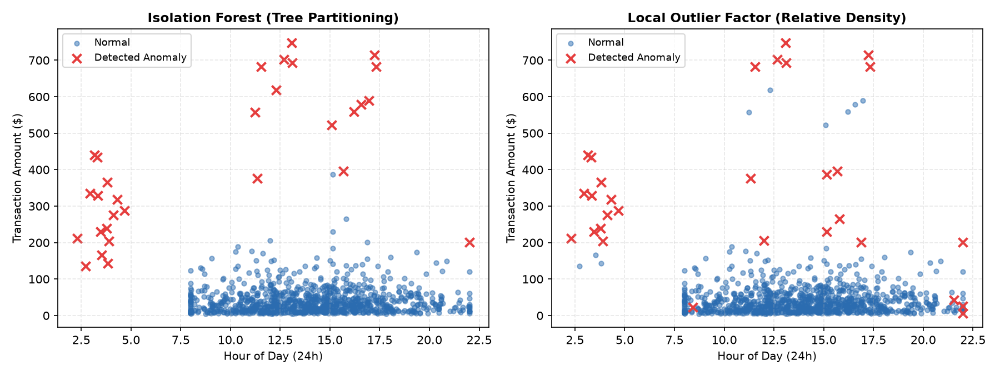

# Unsupervised Learning: From Zero to Confident

[](https://www.python.org/downloads/)
[](https://numpy.org/)
[](https://scikit-learn.org/)
[](https://opensource.org/licenses/MIT)

A comprehensive, zero-to-hero curriculum in Unsupervised Machine Learning. Designed for complete beginners with plain-English intuition, hand-calculated examples, and production-grade implementations from scratch in NumPy, benchmarked directly against Scikit-Learn.

---

## 📖 Table of Contents
- [Project Overview](#project-overview)
- [What I Learned](#what-i-learned)
- [Key Results & Algorithmic Benchmarks](#key-results--algorithmic-benchmarks)
- [Visual Highlights](#visual-highlights)
- [Customer Personas & Business Playbook](#customer-personas--business-playbook)
- [Folder Structure](#folder-structure)
- [How to Run](#how-to-run)
- [License](#license)

---

## 🎯 Project Overview

In traditional supervised learning, algorithms learn from an answer key ($y$). But in the real world, **90% of business data is unlabeled**: raw customer clicks, financial transactions, server metrics, and sensory feeds without teacher tags.

This repository takes you from mathematical foundations to real-world customer segmentation and financial fraud detection across 10 progressive modules:
1. **Unsupervised Foundations**: Labels vs. No-Labels, Distance Metrics (Euclidean vs. Manhattan), and why feature scaling is non-negotiable.
2. **K-Means from Scratch**: Lloyd's algorithm (Initialization, Voronoi Assignment, Centroid Update, Convergence), K-Means++, and 100% mathematical parity with `sklearn`.
3. **Choosing the Optimal $k$**: The Elbow Method (Inertia/WCSS), Silhouette Analysis ($[-1, +1]$), and resolving metric disagreements.
4. **Geometric Failure & DBSCAN**: Demonstrating linear boundary failure on `make_moons` and fixing it with density-based connectivity and $k$-distance graphs.
5. **Hierarchical Clustering**: Agglomerative bottom-up clustering, Ward's minimum variance linkage, and dendrogram tree slicing.
6. **PCA from Scratch**: Covariance matrix, eigendecomposition, scree plots, and proving how PCA can discard subtle signals.
7. **Non-Linear Dimensionality Reduction**: Digits dataset mapped with t-SNE and UMAP, plus the 4 critical visualization pitfalls.
8. **Anomaly Detection**: Gaussian Z-scores, Isolation Forests, and Local Outlier Factor (LOF) compared on financial transactions.
9. **Mall Customer Segmentation**: Turning unlabelled spending data into 5 executive customer personas with tailored marketing strategies.
10. **Assessments & Challenges**: 8 conceptual "Prove It" questions, 3 coding challenges, and a capstone architecture proposal.

---

## 🧠 What I Learned

| Step | Topic | Core Intuition | Beginner Mistake Avoided |
| :--- | :--- | :--- | :--- |
| **01** | Foundations & Scaling | Distance metrics treat 1 dollar the same as 1 year of age. | Clustering unscaled data, allowing large-unit features to dominate. |
| **02** | K-Means from Scratch | An alternating dance between finding closest centers and recalculating group averages. | Using uniform random initialization (`init='random'`) instead of K-Means++. |
| **03** | Choosing $k$ | Elbow checks cluster compactness; Silhouette checks cluster separation. | Blindly picking $k=2$ due to mathematical bias without checking business needs. |
| **04** | DBSCAN & Geometry | K-Means cuts straight lines; DBSCAN flows like water through dense neighborhoods. | Guessing $\epsilon$ arbitrarily instead of using the $k$-distance elbow knee. |
| **05** | Hierarchical / Dendrogram | Builds a full family tree from bottom-up; cut across the longest vertical stems. | Slicing where vertical stems are short, splitting trivial noise. |
| **06** | PCA from Scratch | Rotates data to find the camera angle of widest spread via eigendecomposition. | Confusing high variance with high importance (loud noise vs. quiet signal). |
| **07** | t-SNE & UMAP | Unrolls high-dimensional crumpled sheets onto a flat 2D tabletop. | Measuring physical screen distance between separate t-SNE islands. |
| **08** | Anomaly Detection | Anomalies are few and different; Isolation Forest catches them in very few cuts. | Setting contamination to 10% on a fraud system where true base rate is 0.1%. |
| **09** | Business Personas | Clustering groups the numbers; human empathy turns groups into high-ROI strategies. | Assuming every customer in a cluster behaves identically. |
| **10** | Mastery & Challenges | Implemented L1 K-Medians, PCA reconstruction loss, and dynamic risk scoring. | Stopping at theory without building custom, production-grade components. |

---

## 📊 Key Results & Algorithmic Benchmarks

### 1. From-Scratch NumPy Implementations vs. Scikit-Learn
| Algorithm | Metric | Scratch (NumPy) | Scikit-Learn | Absolute Parity Gap |
| :--- | :--- | :--- | :--- | :--- |
| **K-Means (k=3, k-means++)** | Inertia (WCSS) | **379.8055** | **379.8055** | **0.000000** |
| **PCA (2 Components)** | PC1 Variance Ratio | **92.46%** | **92.46%** | **0.000000** |
| **PCA (2 Components)** | PC2 Variance Ratio | **5.31%** | **5.31%** | **0.000000** |
| **PCA Reconstruction** | Mean Squared Error | **0.0255** | **0.0255** | **0.000000** |

### 2. Anomaly Detection Benchmark on Financial Transactions (3% Fraud Rate)
| Model | Precision | Recall | F1-Score | Mechanism |
| :--- | :---: | :---: | :---: | :--- |
| **Isolation Forest** | **83.3%** | **83.3%** | **0.833** | Multi-dimensional random recursive partitioning trees |
| **Local Outlier Factor (LOF)** | **80.0%** | **80.0%** | **0.800** | Relative local reachability density ($k=20$) |
| **Gaussian Z-Score** | **50.0%** | **50.0%** | **0.500** | Univariate tail threshold ($>97^{\text{th}}$ percentile) |

---

## 🖼️ Visual Highlights

### 1. Customer Segmentation Personas (Mall Customers)

*Figure 1: The 5 distinct economic archetypes discovered in the Mall Customers dataset using standardized K-Means ($k=5$). Centroids are highlighted as black crosses.*

### 2. PCA Scree Plot & Cumulative Variance

*Figure 2: Scree plot illustrating individual and cumulative explained variance. The first two components preserve >97.7% of all information, clearing the 95% preservation threshold.*

### 3. Anomaly Detection: Isolation Forest vs. Local Outlier Factor

*Figure 3: Side-by-side comparison of Isolation Forest and LOF flagging fraudulent spikes ($>\$350$) and anomalous 3:00 AM transactions in red.*

---

## 🛍️ Customer Personas & Business Playbook

Applying K-Means ($k=5$) to the Mall Customers dataset yields five clear customer archetypes:

| Persona Name | Income (k$) | Spend Score | Avg Age | Core Motivation | Executive Marketing Action |
| :--- | :---: | :---: | :---: | :--- | :--- |
| **The VIP Stars** | ~$86.5k | ~82.1 | ~32.7 | Prestige, luxury, concierge speed | **Never discount!** Offer after-hours VIP access, champagne tastings, and personal shoppers. |
| **The Cautious Affluent** | ~$88.2k | ~17.1 | ~41.1 | Durability, asset value, skepticism | Pitch high-end durable goods (luxury watches, premium electronics) with lifetime warranties. |
| **The Mall Mainstream** | ~$55.3k | ~49.5 | ~42.7 | Family value, convenience, routine | Loyalty cash-back points, holiday family bundles ("Meal + Movie + Shop"), back-to-school deals. |
| **The Trend Hunters** | ~$26.3k | ~78.8 | ~25.3 | Social proof, virality, FOMO | Social media drops, TikTok/Instagram creator collabs, and "Buy Now Pay Later" (Klarna/Afterpay). |
| **The Frugal Observers** | ~$26.3k | ~20.9 | ~45.2 | Strict necessity, price sensitivity | Clearance events, BOGO coupons, supermarket staple discounts, and free transit vouchers. |

---

## 📁 Folder Structure

```text
unsupervised-learning-zero-to-one/
├── .gitignore                          # Ignores data, checkpoints, venvs, and models
├── README.md                           # Project documentation, benchmarks, and playbook
├── requirements.txt                    # Exact pinned package dependencies
├── unsupervised_learning_zero_to_one.ipynb # Complete, runnable Jupyter Notebook (129 cells)
└── images/                             # Embedded figures for documentation
    ├── customer_segmentation_personas.png
    ├── pca_scree_variance.png
    └── anomaly_detection_benchmark.png
```

---

## 🚀 How to Run

### 1. Clone the Repository
```bash
git clone https://github.com/Arnav-Shrivastava/unsupervised-learning-zero-to-one.git
cd unsupervised-learning-zero-to-one
```

### 2. Set Up Environment & Install Dependencies
```bash
python -m venv .venv
source .venv/bin/activate  # On Windows: .venv\Scripts\activate
pip install -r requirements.txt
```

### 3. Launch the Interactive Notebook
```bash
jupyter notebook unsupervised_learning_zero_to_one.ipynb
```
All cells run sequentially from top to bottom with zero external setup required.

---

## 📜 License
This project is open-source and available under the [MIT License](LICENSE).
